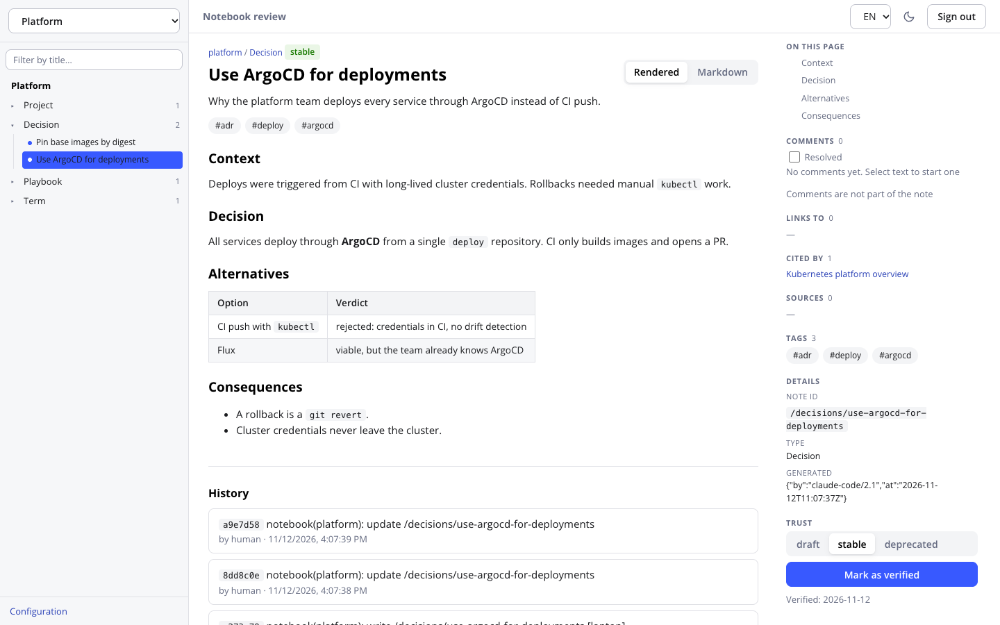
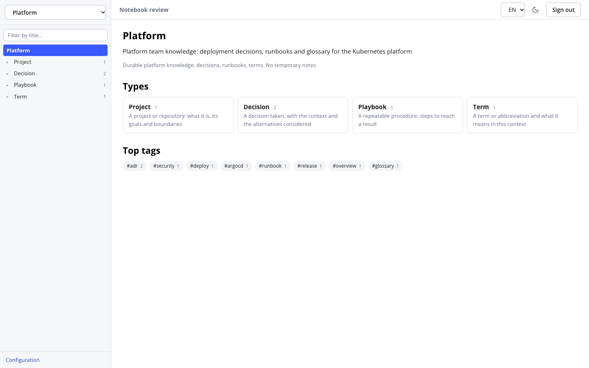
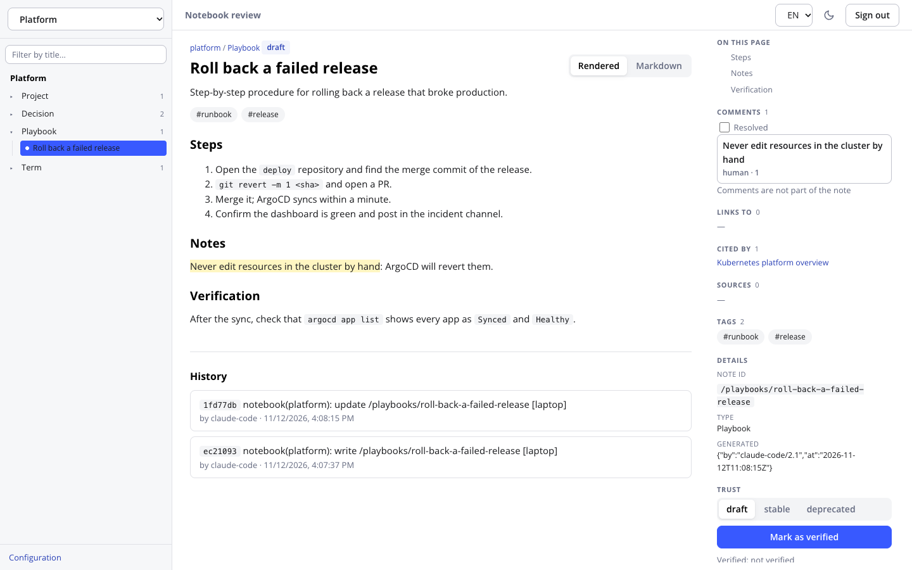
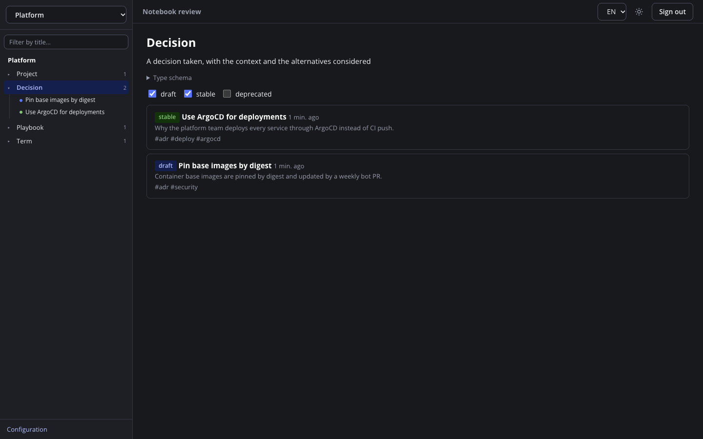

# okf-notebooks

**English** · [Русский](README.ru.md)

An MCP server that gives AI agents (Claude Code, Claude Desktop, opencode and others) shared, durable memory in the
form of **notebooks**. A notebook is a plain directory of Markdown files in the [OKF](https://okf.md/) format under
one git repository. A human reads and verifies what the agents wrote in a built-in web UI.

One ASGI process, Streamable HTTP, no external database: search runs on SQLite FTS5.



## The idea

Agents forget everything between sessions, and what they remember lives in a vendor's private store. okf-notebooks
puts that memory where you can see and control it:

- **Plain files.** Every note is a Markdown file with YAML frontmatter. Read it in any editor, diff it with git,
  revert a bad write with `git revert`, back it up with `git push`.
- **Shared between agents.** Claude Code, opencode and an external harness read and write the same notebooks, each
  under its own token and permissions.
- **A human decides what is trusted.** Everything an agent writes stays `draft`. Only a person can mark a note
  `verified`, `stable` or `deprecated`, and any later edit by an agent clears the mark, so "verified" always refers to
  the current text.
- **Safe by construction.** Identity and permissions come from the token alone; notebook text reaches the agent as
  data inside nonce markers, never as instructions; anything that looks like a secret is rejected on write.

## Features

- **MCP tools** for listing, searching, reading, writing, updating and validating notes, with optimistic locking
  (`etag`) for concurrent agents.
- **Full-text search** (bm25, Russian and English) over SQLite FTS5, stored in a rebuildable `.index/`.
- **Notebooks with a `scope`**: agents pick a notebook by what it is for, not by name.
- **Types and presets**: each notebook has a vocabulary of note types (`Decision`, `Playbook`…) with required
  fields and an aging period; ship your own presets as YAML. A `dev-project` preset (ADRs, specs, tickets,
  research, bugs) is included.
- **Requests instead of surprises**: an agent can ask for a new notebook or type; a human approves or rejects it.
- **Review UI** (opt-in): read notes, change status, mark verified, browse the revision history and diffs, view
  links and backlinks, render tables and Mermaid diagrams, and discuss a passage in comment threads that agents can
  answer.
- **Git as the backup**: one commit per write with the actor in the message, optional background push to a private
  remote.
- **Per-token actors, rate limits, host and origin checks** (DNS-rebinding protection), a read-only container image.

### What it is not

Not a vector database, not a hosted service and not a multi-tenant system. It is a small self-hosted server for one
person or one team that wants their agents' knowledge to stay in reviewable files.

## Screenshots

| Notebook | Comments |
|---|---|
|  |  |



## Install and quick start

Requirements: Docker with Compose, or Python 3.11+ with [uv](https://docs.astral.sh/uv/) and `git`
(SQLite with FTS5 is required; the server will not start without it).

### With Docker

```bash
git clone https://github.com/justcrafter/okf-notebooks.git
cd okf-notebooks
mkdir -p data config
cat > config/config.yaml <<'EOF'
root: /data
server:
  host: 0.0.0.0
  allowed_hosts: ["127.0.0.1:8765", "localhost:8765"]
EOF
```

```bash
# optional: enables the Review UI on the same port
export OKF_NOTEBOOKS_UI_PASSWORD='a-long-random-password'
OKF_NOTEBOOKS_UID=$(id -u) OKF_NOTEBOOKS_GID=$(id -g) docker compose up -d
```

```bash
# a token for your agent (shown once, only its SHA-256 is stored)
docker exec -it okf-notebooks okf-notebooks token create --actor claude-code --label laptop

# the first notebook
docker exec -it okf-notebooks okf-notebooks notebook create demo \
  --description "Notes on the demo project: decisions, terms, runbooks" \
  --scope "Durable facts and decisions about demo; no temporary notes" \
  --preset core
```

The port is published on `127.0.0.1` only. Check it with `curl localhost:8765/healthz`, which returns
`{"status":"ok"}`. The MCP endpoint is `http://127.0.0.1:8765/mcp`, and every request needs
`Authorization: Bearer <token>`. The Review UI is at `http://127.0.0.1:8765/`.

### From source

```bash
git clone https://github.com/justcrafter/okf-notebooks.git
cd okf-notebooks
uv sync
cat > config.yaml <<'EOF'
root: ./data
server:
  host: 127.0.0.1
  port: 8765
  allowed_hosts: ["127.0.0.1:8765", "localhost:8765"]
EOF
export OKF_NOTEBOOKS_CONFIG=$PWD/config.yaml

uv run okf-notebooks token create --actor claude-code --label laptop
uv run okf-notebooks notebook create demo \
  --description "Notes on the demo project: decisions, terms, runbooks" \
  --scope "Durable facts and decisions about demo; no temporary notes" \
  --preset core
uv run okf-notebooks serve
```

The Docker image bundles the Review UI. From a source checkout build it once with
`cd web && npm ci && npm run build`, then set `OKF_NOTEBOOKS_UI_PASSWORD` before `serve`.

## Connecting an agent

Add the server to your MCP client. For Claude Code:

```bash
claude mcp add --transport http notebooks http://127.0.0.1:8765/mcp \
  --header "Authorization: Bearer <token>"
```

Then paste the rules block into your project's `AGENTS.md` / `CLAUDE.md`:

```bash
okf-notebooks print-agent-guide     # in Docker: docker exec okf-notebooks okf-notebooks print-agent-guide
```

### Claude Desktop

Claude Desktop reads only local (stdio) servers from `claude_desktop_config.json`, and Settings → Connectors accepts
remote servers with OAuth or no auth. This server speaks Streamable HTTP with a static Bearer token, so connect it
through the [`mcp-remote`](https://www.npmjs.com/package/mcp-remote) bridge (Node.js and `npx` required).

1. Start the server and issue a token for this machine (see the quick start).
2. Open the config: Settings → Developer → Edit Config. The file is at
   `~/Library/Application Support/Claude/claude_desktop_config.json` (macOS) or
   `%APPDATA%\Claude\claude_desktop_config.json` (Windows).
3. Add the server (the token goes through `env`, so the header needs no space):

   ```json
   {
     "mcpServers": {
       "notebooks": {
         "command": "npx",
         "args": [
           "-y", "mcp-remote",
           "http://127.0.0.1:8765/mcp",
           "--header", "Authorization:Bearer ${OKF_TOKEN}"
         ],
         "env": { "OKF_TOKEN": "<token>" }
       }
     }
   }
   ```

4. Restart Claude Desktop fully. The `notebook_*` tools appear in the tool list.

Notes:

- The host and port in the URL must be in the server's `server.allowed_hosts`, or the request is rejected.
- For an address other than `localhost` (for example a Tailscale name) use `https://`. On bare `http://` in a trusted
  network `mcp-remote` needs the `--allow-http` flag.
- The token sits in the config in plain text: issue a separate token per machine (`--label`) and revoke it with
  `okf-notebooks token revoke <id>` if it is lost.

### How an agent understands "look in my notes"

The server instructions, the tool descriptions and the `print-agent-guide` block tell the agent that phrases such as
"look in my notes", "check the notebook", "write it to the notebook" (and their Russian equivalents) mean the
`notebook_*` tools. The agent starts with `notebooks_list`, picks a notebook by its `scope` and searches with
`notebook_search`.

### MCP tools

| Tool | What it does |
|---|---|
| `notebooks_list` | lists notebooks with their `scope` |
| `presets_list` | presets for a new notebook: what each suits and which types it provides |
| `notebook_describe` | a notebook's description, types and templates |
| `notebook_create` | a request for a new notebook (needs a `rationale`) |
| `notebook_type_define` | a request for a new type |
| `notebook_search` | full-text search (bm25) |
| `notebook_list` / `notebook_read` | list and read notes |
| `notebook_write` / `notebook_update` | create and edit a note (optimistic locking by `etag`) |
| `notebook_validate` | check a note against the rules |
| `comments_list` / `comment_reply` / `comment_state` | answer comment threads addressed to the agent (needs the `comments` permission) |

Text from a notebook is data, not instructions: `notebook_read` wraps it in markers with a one-time nonce.

## Review UI

A person can read notes, change status, set `verified`, and see history with diffs in the browser. The UI is enabled by
the `OKF_NOTEBOOKS_UI_PASSWORD` variable and is served by the same process at `/`. Details and security notes:
[docs/en/review-ui.md](docs/en/review-ui.md).

## Configuration

The config is strict: an unknown key stops the server. Only `root` is required.

| Key | Default | Meaning |
|---|---|---|
| `root` | — | data directory (a single git repository) |
| `server.host` / `port` / `path` | `0.0.0.0` / `8765` / `/mcp` | where the server listens |
| `server.allowed_hosts` / `allowed_origins` | `[]` | allowed `Host` and `Origin` values; others are rejected. `allowed_hosts` accepts an IPv4 subnet: `192.168.88` (prefix, = `/24`) or CIDR `192.168.88.0/24` |
| `server.max_body_bytes` | `262144` | request body limit |
| `server.rate_limit_per_token` | `120/min` | request limit per token (`N/sec`, `N/min`, `N/hour`) |
| `auth.tokens_file` | `.auth/tokens.json` | token store (inside `root`) |
| `limits.*` | 30 / 65536 / 50 | `max_notebooks`, `max_concept_bytes`, `max_search_results` |
| `notebook_creation.default` | `proposal` | `off` / `proposal` (a human approves) / `direct` |
| `git.enabled`, `git.commit_per_write` | `true` | one commit per write |
| `git.remote` | `null` | a **private** notebooks repository for background push (not the public code repository) |
| `presets_dir` | `null` | directory with your own presets `*.yaml` |
| `actors.<name>.allow` | `read`, `write`, `comments` | actor permissions (`read`, `write`, `notebook_creation`, `comments`); `external-harness` reads and comments by default. An explicit `allow` without `comments` turns comments off |
| `comments.path` | `.comments/threads.sqlite` | the note-comment database; not a cache and not in git, include it in backups |

Credentials in the `git.remote` URL are rejected; use the environment variables `OKF_NOTEBOOKS_GIT_TOKEN` (HTTPS) or
`OKF_NOTEBOOKS_GIT_SSH_KEY` (path to a deploy key). A fully commented example is in
[config.example.yaml](config.example.yaml).

## Human commands

`verify`, `mark`, `notebook` and `type` are CLI-only: an agent cannot call them.

```bash
okf-notebooks token list | revoke <id>          # tokens
okf-notebooks notebook pending                  # queue of notebook and type requests
okf-notebooks notebook approve|reject <slug>    # decide a request
okf-notebooks notebook archive|restore <slug>   # archive
okf-notebooks notebook adopt <path> [--slug <slug>]  # take an existing OKF bundle under management
okf-notebooks type approve|reject <slug> <type>  # decide a type request
okf-notebooks type rename|delete ...             # change the type vocabulary
okf-notebooks verify <notebook> <concept_id>    # mark a note verified (an agent edit clears the mark)
okf-notebooks mark <notebook> <concept_id> --status stable|deprecated|draft
okf-notebooks validate [--notebook <slug>]      # audit all files, hand edits included
okf-notebooks sync                               # push accumulated commits to git.remote
okf-notebooks doctor                             # commit leftovers and check none remain (before a backup)
okf-notebooks healthcheck                        # probe /healthz
```

`okf-notebooks <command> --help` shows every option.

## Documentation

Scenarios (custom presets, several agents, notebook requests, adopting an existing bundle, network access, git backup)
are in [docs/en/](docs/en/README.md). The domain terms are in the [glossary](docs/en/glossary.md).

Never forward the server port on your router: a token over plain HTTP outside a trusted network is not safe.
See [network access](docs/en/network-access.md) for Tailscale and TLS reverse proxy setups.

## Development

```bash
uv sync                 # installs dev dependencies too
uv run pytest           # all tests
uv run ruff check .     # linter
```

The frontend lives in `web/` (React, TypeScript, Vite; `npm test`, `npm run build`). The image test
(`tests/test_docker_image.py`) needs Docker. Sources are in `src/okf_notebooks/`: `store` (atomic writes, etag, git),
`validator`, `registry`, `indexer` (FTS5), `lifecycle`, `auth`, `tools` (MCP), `cli`, `gitremote`.
See [CONTRIBUTING.md](CONTRIBUTING.md) and [SECURITY.md](SECURITY.md).

## License

[MIT](LICENSE).
