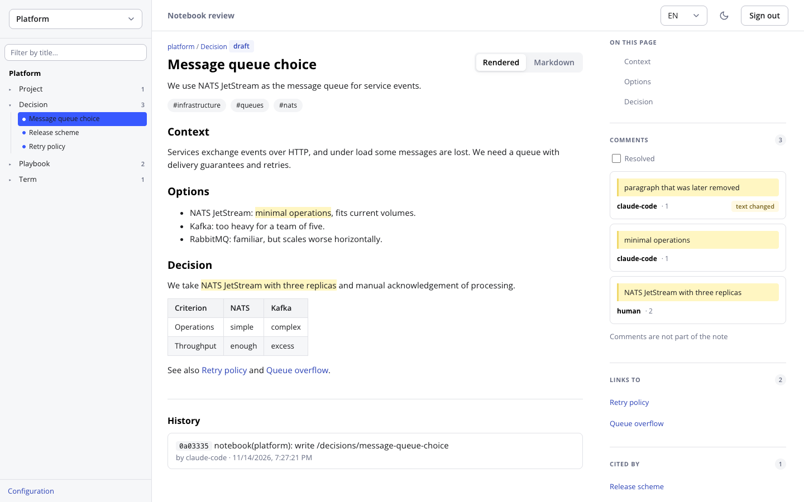
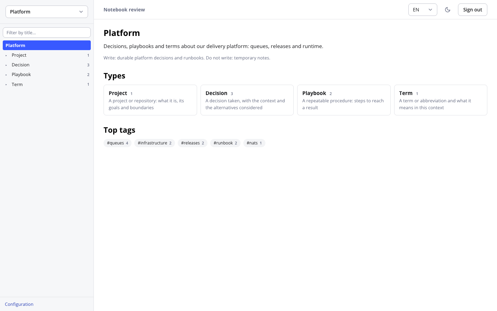
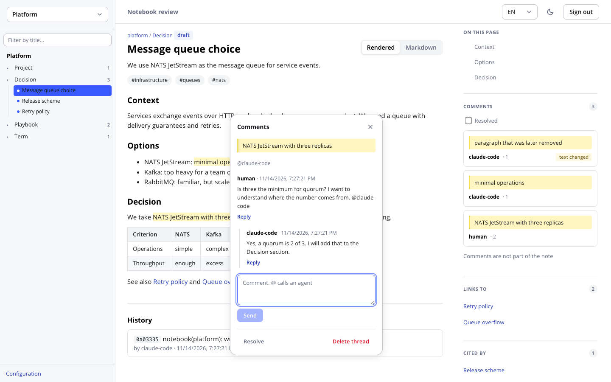
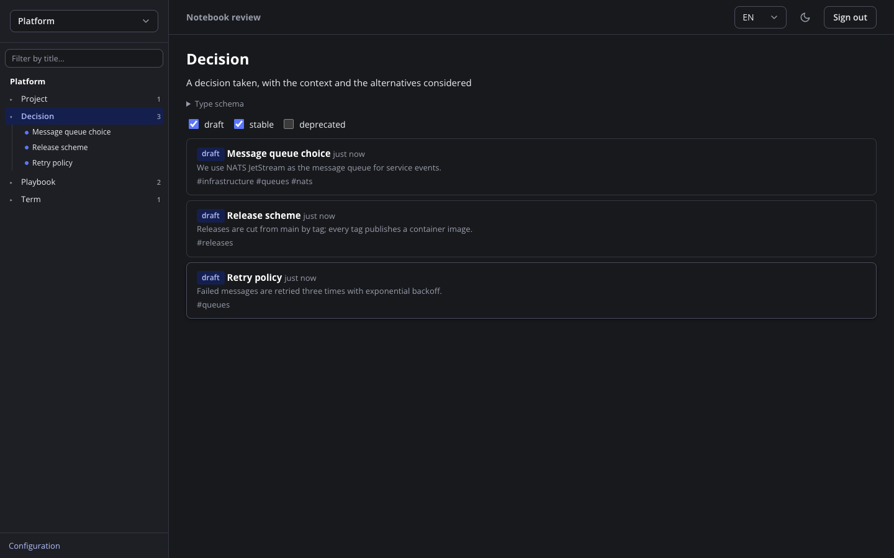

# okf-notebooks

**English** · [Русский](README.ru.md)

An MCP server that gives AI agents (Claude Code, Claude Desktop, opencode and others) shared, durable memory in the
form of **notebooks**. A notebook is a plain directory of Markdown files in the [OKF](https://okf.md/) format under
one git repository. A human reads and verifies what the agents wrote in a built-in web UI.

One ASGI process, Streamable HTTP, no external database: search runs on SQLite FTS5.



## The idea

Agents forget everything between sessions, and what they remember lives in a vendor's private store. okf-notebooks
puts that memory where you can see and control it:

- **Plain files.** Every note is a Markdown file with YAML frontmatter. Read it in any editor, diff it with git,
  revert a bad write with `git revert`, back it up with `git push`.
- **Shared between agents.** Claude Code, opencode and an external harness read and write the same notebooks, each
  under its own token and permissions.
- **A human decides what is trusted.** Everything an agent writes stays `draft`. Only a person can mark a note
  `verified`, `stable` or `deprecated`, and any later edit by an agent clears the mark, so "verified" always refers to
  the current text.
- **Safe by construction.** Identity and permissions come from the token alone; notebook text reaches the agent as
  data inside nonce markers, never as instructions; anything that looks like a secret is rejected on write.

## Features

- **MCP tools** for listing, searching, reading, writing, updating and validating notes, with optimistic locking
  (`etag`) for concurrent agents.
- **Full-text search** (bm25, Russian and English) over SQLite FTS5, stored in a rebuildable `.index/`.
- **Notebooks with a `scope`**: agents pick a notebook by what it is for, not by name.
- **Types and presets**: each notebook has a vocabulary of note types (`Decision`, `Playbook`…) with required
  fields and an aging period; ship your own presets as YAML. Ready-made presets are included: `dev-project`
  (ADRs, specs, tickets, research, bugs), `personal-finance` and `agent-retros`.
- **Requests instead of surprises**: an agent can ask for a new notebook or type; a human approves or rejects it.
- **Review UI** (opt-in): read notes, change status, mark verified, browse the revision history and diffs, view
  links and backlinks, render tables and Mermaid diagrams, and discuss a passage in comment threads that agents can
  answer.
- **Git as the backup**: one commit per write with the actor in the message, optional background push to a private
  remote.
- **Per-token actors, rate limits, host and origin checks** (DNS-rebinding protection), a read-only container image.

### What it is not

Not a vector database, not a hosted service and not a multi-tenant system. It is a small self-hosted server for one
person or one team that wants their agents' knowledge to stay in reviewable files.

## Screenshots

| Notebook | Comments |
|---|---|
|  |  |



## Quick start

With Docker and Compose:

```bash
git clone https://github.com/justcrafter/okf-notebooks.git
cd okf-notebooks
mkdir -p data config
cat > config/config.yaml <<'EOF'
root: /data
server:
  host: 0.0.0.0
  allowed_hosts: ["127.0.0.1:8765", "localhost:8765"]
EOF

# optional: enables the Review UI on the same port
export OKF_NOTEBOOKS_UI_PASSWORD='a-long-random-password'
OKF_NOTEBOOKS_UID=$(id -u) OKF_NOTEBOOKS_GID=$(id -g) docker compose up -d

# a token for your agent (shown once) and the first notebook
docker exec -it okf-notebooks okf-notebooks token create --actor claude-code --label laptop
docker exec -it okf-notebooks okf-notebooks notebook create demo \
  --description "Notes on the demo project: decisions, terms, runbooks" \
  --scope "Durable facts and decisions about demo; no temporary notes" \
  --preset core

# connect Claude Code
claude mcp add --transport http notebooks http://127.0.0.1:8765/mcp \
  --header "Authorization: Bearer <token>"
```

The MCP endpoint is `http://127.0.0.1:8765/mcp`, the Review UI is at `http://127.0.0.1:8765/`.

## Documentation

Everything else is on **[okf-notebooks.kazakov.dev](https://okf-notebooks.kazakov.dev/)**:

- [Install](https://okf-notebooks.kazakov.dev/install/): Docker and source installs, Claude Code and Claude Desktop, the MCP tools,
  the configuration reference and the human CLI commands;
- [Scenarios](https://okf-notebooks.kazakov.dev/scenarios/): memory for one agent, a project knowledge base, several agents, human review,
  adopting existing notes, network access and backup;
- [Documentation](https://okf-notebooks.kazakov.dev/docs/): the notebook format, presets, lifecycle, verification, Review UI, git and the
  [glossary](https://okf-notebooks.kazakov.dev/docs/glossary/).

Never forward the server port on your router: a token over plain HTTP outside a trusted network is not safe.
See [network access](https://okf-notebooks.kazakov.dev/docs/network-access/) for Tailscale and TLS reverse proxy setups.

The site's source is in [`site/`](site/).

## Development

```bash
uv sync                 # installs dev dependencies too
uv run pytest           # all tests
uv run ruff check .     # linter
```

The frontend lives in `web/` (React, TypeScript, Vite; `npm test`, `npm run build`). The image test
(`tests/test_docker_image.py`) needs Docker. Sources are in `src/okf_notebooks/`: `store` (atomic writes, etag, git),
`validator`, `registry`, `indexer` (FTS5), `lifecycle`, `auth`, `tools` (MCP), `cli`, `gitremote`.
See [CONTRIBUTING.md](CONTRIBUTING.md) and [SECURITY.md](SECURITY.md).

## License

[MIT](LICENSE).
