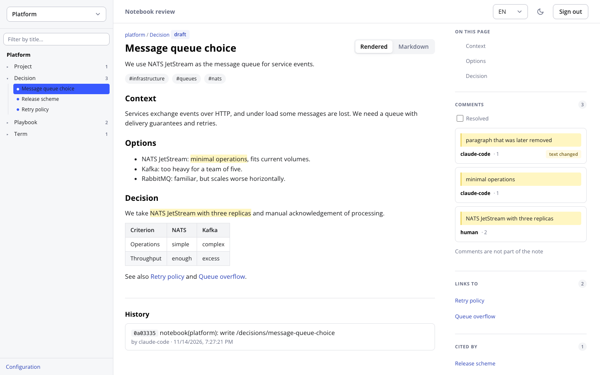
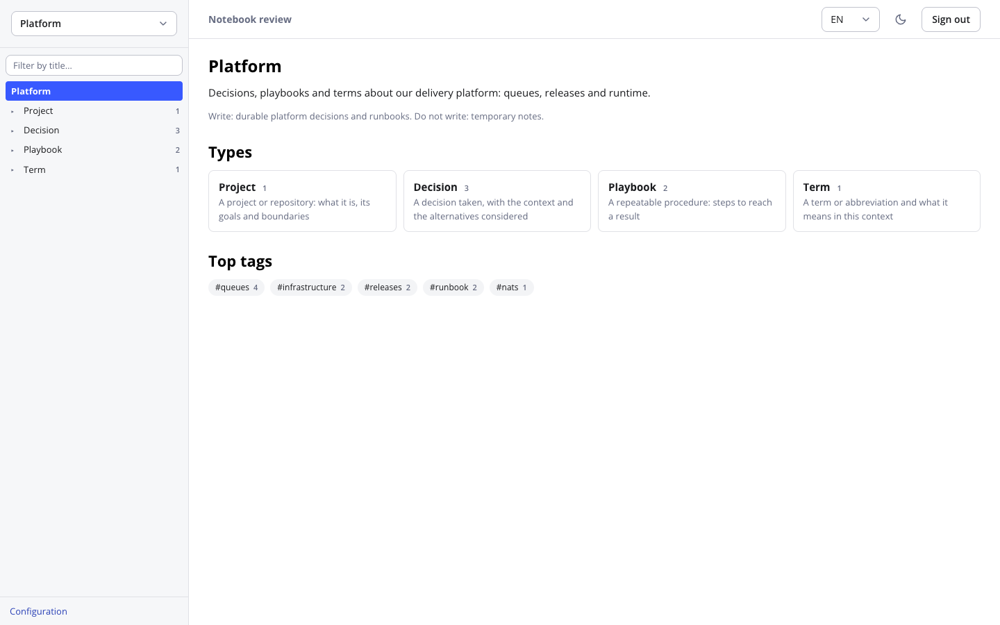
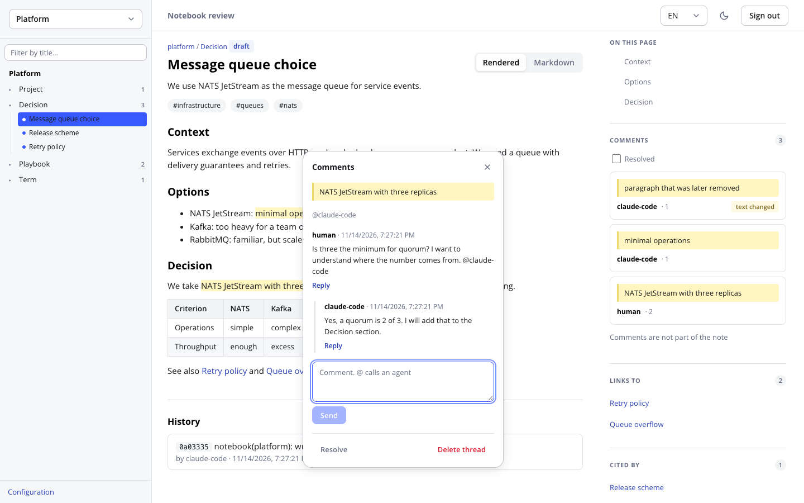
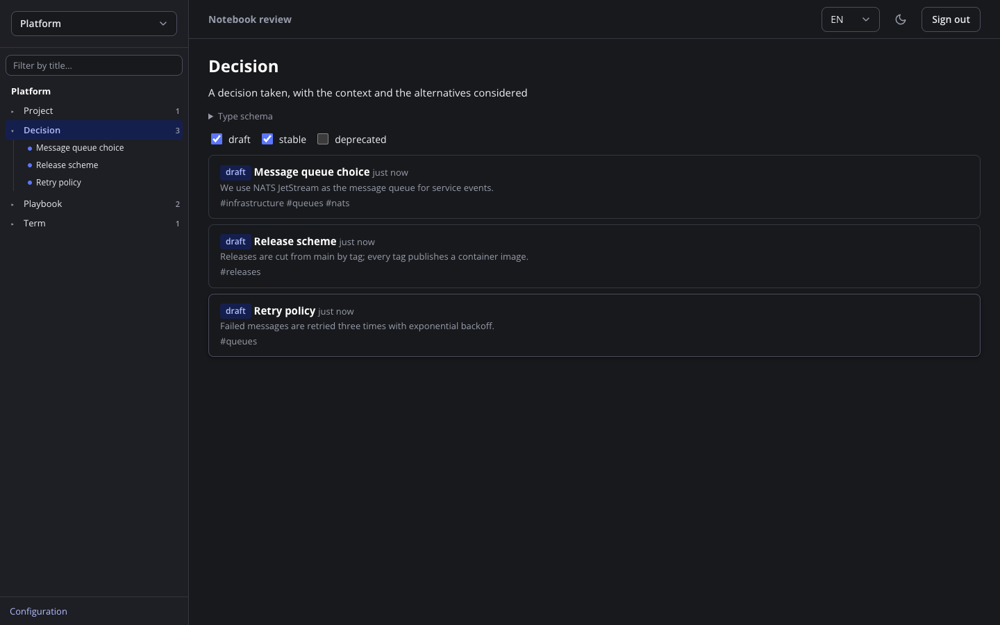

# okf-notebooks

[English](README.md) · **Русский**

MCP-сервер, который даёт ИИ-агентам (Claude Code, Claude Desktop, opencode и другим) общую долговременную память в виде
**блокнотов**. Блокнот — это обычный каталог Markdown-файлов в формате [OKF](https://okf.md/) под одним
git-репозиторием. Человек читает и проверяет написанное агентами во встроенном веб-интерфейсе.

Один ASGI-процесс (Streamable HTTP), без внешней БД: поиск идёт по SQLite FTS5.



## Идея

Агенты забывают всё между сессиями, а то, что помнят, лежит в закрытом хранилище вендора. okf-notebooks кладёт эту
память туда, где вы её видите и контролируете:

- **Обычные файлы.** Каждая заметка — Markdown с YAML-frontmatter. Её можно открыть в любом редакторе, сравнить через
  git, откатить неудачную запись через `git revert` и сохранить через `git push`.
- **Общая для агентов.** Claude Code, opencode и внешний harness читают и пишут в одни и те же блокноты, каждый со
  своим токеном и правами.
- **Доверие определяет человек.** Всё, что пишет агент, остаётся `draft`. Только человек может поставить `verified`,
  `stable` или `deprecated`, а любая последующая правка агентом снимает отметку, так что «проверено» всегда
  относится к текущему тексту.
- **Безопасность по построению.** Личность и права определяются только токеном; текст блокнота приходит агенту как
  данные в маркерах с одноразовым nonce, а не как инструкции; всё, что похоже на секрет, отклоняется при записи.

## Возможности

- **MCP-инструменты** для списка, поиска, чтения, записи, правки и проверки заметок; оптимистичная блокировка
  (`etag`) для параллельных агентов.
- **Полнотекстовый поиск** (bm25, русский и английский) на SQLite FTS5 в пересоздаваемом `.index/`.
- **Блокноты со `scope`**: агент выбирает блокнот по назначению, а не по имени.
- **Типы и пресеты**: у блокнота свой словарь типов заметок (`Decision`, `Playbook`…) с обязательными полями и сроком
  устаревания; свои пресеты задаются YAML-файлами. В комплекте готовые пресеты: `dev-project` (ADR,
  спеки, тикеты, исследования, баги), `personal-finance` и `agent-retros`.
- **Заявки вместо сюрпризов**: агент может запросить новый блокнот или тип, а человек одобряет или отклоняет.
- **Веб-интерфейс ревью** (включается по желанию): чтение заметок, смена статуса, `verified`, история ревизий с diff,
  ссылки и обратные ссылки, таблицы и диаграммы Mermaid, обсуждение фрагмента в тредах комментариев, на которые
  отвечают агенты.
- **Git как бэкап**: коммит на каждую запись с актором в сообщении, необязательный фоновый push в приватный remote.
- **Акторы по токенам, лимиты запросов, проверка Host и Origin** (защита от DNS-rebinding), образ контейнера только
  для чтения.

### Чем проект не является

Это не векторная база данных, не облачный сервис и не мультитенантная система. Это небольшой сервер для одного
человека или одной команды, который хранит знания агентов в файлах, доступных для ревью.

## Скриншоты

| Блокнот | Комментарии |
|---|---|
|  |  |



Интерфейс двуязычный (EN/RU): язык переключается в шапке.

## Быстрый старт

Через Docker с Compose:

```bash
git clone https://github.com/justcrafter/okf-notebooks.git
cd okf-notebooks
mkdir -p data config
cat > config/config.yaml <<'EOF'
root: /data
server:
  host: 0.0.0.0
  allowed_hosts: ["127.0.0.1:8765", "localhost:8765"]
EOF

# необязательно: включает веб-интерфейс ревью на том же порту
export OKF_NOTEBOOKS_UI_PASSWORD='длинный-случайный-пароль'
OKF_NOTEBOOKS_UID=$(id -u) OKF_NOTEBOOKS_GID=$(id -g) docker compose up -d

# токен для агента (показывается один раз) и первый блокнот
docker exec -it okf-notebooks okf-notebooks token create --actor claude-code --label laptop
docker exec -it okf-notebooks okf-notebooks notebook create demo \
  --description "Заметки по проекту demo: решения, термины, регламенты" \
  --scope "Устойчивые факты и решения по demo; не писать временные заметки" \
  --preset core

# подключить Claude Code
claude mcp add --transport http notebooks http://127.0.0.1:8765/mcp \
  --header "Authorization: Bearer <токен>"
```

MCP-эндпоинт — `http://127.0.0.1:8765/mcp`, веб-интерфейс ревью — `http://127.0.0.1:8765/`.

## Документация

Всё остальное — на **[okf-notebooks.kazakov.dev](https://okf-notebooks.kazakov.dev/ru/)**:

- [Установка](https://okf-notebooks.kazakov.dev/ru/install/): Docker и установка из исходников, Claude Code и Claude Desktop,
  MCP-инструменты, справочник по конфигурации и команды для человека;
- [Сценарии](https://okf-notebooks.kazakov.dev/ru/scenarios/): память одного агента, база знаний проекта, несколько агентов, проверка
  человеком, подключение существующих заметок, доступ по сети и бэкап;
- [Документация](https://okf-notebooks.kazakov.dev/ru/docs/): формат блокнота, пресеты, жизненный цикл, проверка, веб-интерфейс ревью, git и
  [глоссарий](https://okf-notebooks.kazakov.dev/ru/docs/glossary/).

Не пробрасывайте порт сервера на роутере: токен по голому HTTP за пределами доверенной сети небезопасен.
Tailscale и reverse proxy с TLS — в [доступе по сети](https://okf-notebooks.kazakov.dev/ru/docs/network-access/).

Исходники сайта — в [`site/`](site/).

## Разработка

```bash
uv sync                 # ставит и dev-зависимости
uv run pytest           # все тесты
uv run ruff check .     # линтер
```

Фронтенд — в `web/` (React, TypeScript, Vite; `npm test`, `npm run build`). Тест образа
(`tests/test_docker_image.py`) требует Docker. Исходники — в `src/okf_notebooks/`: `store` (атомарная запись, etag,
git), `validator`, `registry`, `indexer` (FTS5), `lifecycle`, `auth`, `tools` (MCP), `cli`, `gitremote`.
См. [CONTRIBUTING.md](CONTRIBUTING.md) и [SECURITY.md](SECURITY.md) (на английском, с кратким русским резюме).

## Лицензия

[MIT](LICENSE).
