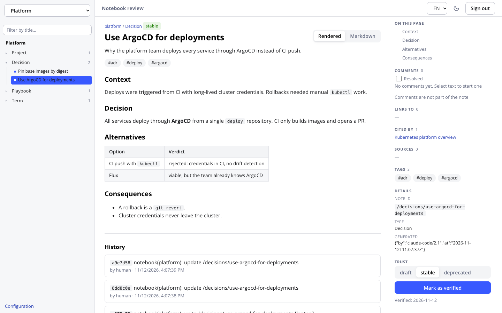
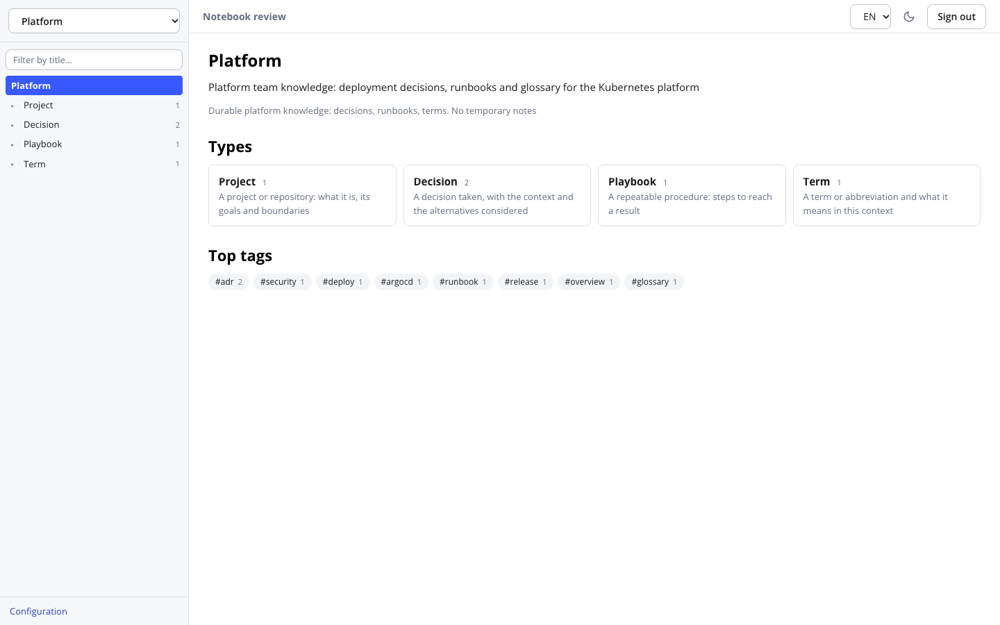
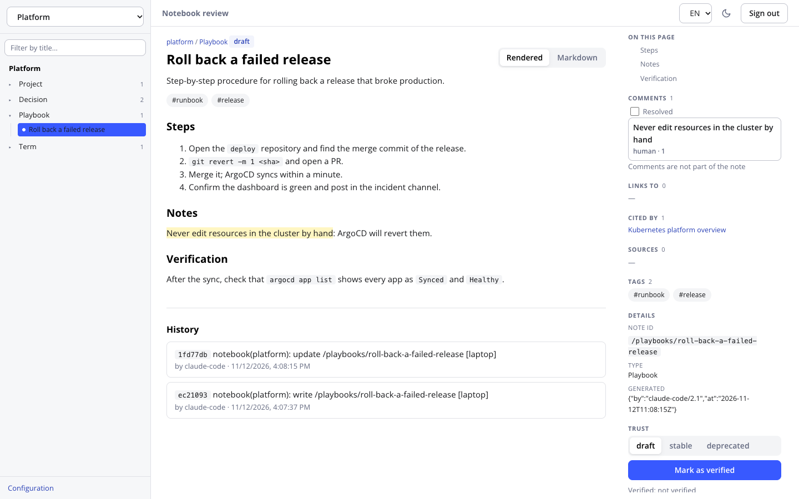
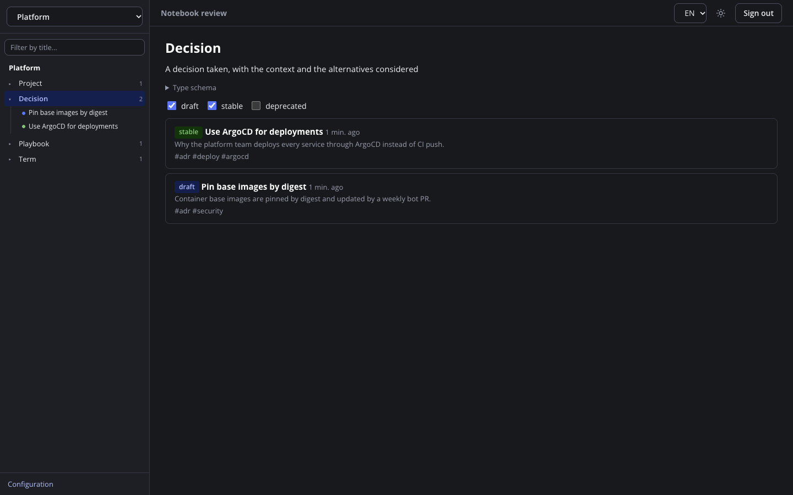

# okf-notebooks

[English](README.md) · **Русский**

MCP-сервер, который даёт ИИ-агентам (Claude Code, Claude Desktop, opencode и другим) общую долговременную память в виде
**блокнотов**. Блокнот — это обычный каталог Markdown-файлов в формате [OKF](https://okf.md/) под одним
git-репозиторием. Человек читает и проверяет написанное агентами во встроенном веб-интерфейсе.

Один ASGI-процесс (Streamable HTTP), без внешней БД: поиск идёт по SQLite FTS5.



## Идея

Агенты забывают всё между сессиями, а то, что помнят, лежит в закрытом хранилище вендора. okf-notebooks кладёт эту
память туда, где вы её видите и контролируете:

- **Обычные файлы.** Каждая заметка — Markdown с YAML-frontmatter. Её можно открыть в любом редакторе, сравнить через
  git, откатить неудачную запись через `git revert` и сохранить через `git push`.
- **Общая для агентов.** Claude Code, opencode и внешний harness читают и пишут в одни и те же блокноты, каждый со
  своим токеном и правами.
- **Доверие определяет человек.** Всё, что пишет агент, остаётся `draft`. Только человек может поставить `verified`,
  `stable` или `deprecated`, а любая последующая правка агентом снимает отметку, так что «проверено» всегда
  относится к текущему тексту.
- **Безопасность по построению.** Личность и права определяются только токеном; текст блокнота приходит агенту как
  данные в маркерах с одноразовым nonce, а не как инструкции; всё, что похоже на секрет, отклоняется при записи.

## Возможности

- **MCP-инструменты** для списка, поиска, чтения, записи, правки и проверки заметок; оптимистичная блокировка
  (`etag`) для параллельных агентов.
- **Полнотекстовый поиск** (bm25, русский и английский) на SQLite FTS5 в пересоздаваемом `.index/`.
- **Блокноты со `scope`**: агент выбирает блокнот по назначению, а не по имени.
- **Типы и пресеты**: у блокнота свой словарь типов заметок (`Decision`, `Playbook`…) с обязательными полями и сроком
  устаревания; свои пресеты задаются YAML-файлами. В комплекте пресет `dev-project` (ADR, спеки, тикеты,
  исследования, баги).
- **Заявки вместо сюрпризов**: агент может запросить новый блокнот или тип, а человек одобряет или отклоняет.
- **Веб-интерфейс ревью** (включается по желанию): чтение заметок, смена статуса, `verified`, история ревизий с diff,
  ссылки и обратные ссылки, таблицы и диаграммы Mermaid, обсуждение фрагмента в тредах комментариев, на которые
  отвечают агенты.
- **Git как бэкап**: коммит на каждую запись с актором в сообщении, необязательный фоновый push в приватный remote.
- **Акторы по токенам, лимиты запросов, проверка Host и Origin** (защита от DNS-rebinding), образ контейнера только
  для чтения.

### Чем проект не является

Это не векторная база данных, не облачный сервис и не мультитенантная система. Это небольшой сервер для одного
человека или одной команды, который хранит знания агентов в файлах, доступных для ревью.

## Скриншоты

| Блокнот | Комментарии |
|---|---|
|  |  |



Интерфейс двуязычный (EN/RU): язык переключается в шапке.

## Установка и быстрый старт

Требования: Docker с Compose либо Python 3.11+ с [uv](https://docs.astral.sh/uv/) и `git`
(нужен SQLite со включённым FTS5, без него сервер не стартует).

### Через Docker

> Образ `ghcr.io/justcrafter/okf-notebooks:0.1.0` ещё не опубликован. Пока его нет, соберите образ сами:
> `docker build -t okf-notebooks:0.1.0 .` и запускайте Compose с `OKF_NOTEBOOKS_IMAGE=okf-notebooks:0.1.0`.

```bash
git clone https://github.com/justcrafter/okf-notebooks.git
cd okf-notebooks
mkdir -p data config
cat > config/config.yaml <<'EOF'
root: /data
server:
  host: 0.0.0.0
  allowed_hosts: ["127.0.0.1:8765", "localhost:8765"]
EOF
```

```bash
# необязательно: включает веб-интерфейс ревью на том же порту
export OKF_NOTEBOOKS_UI_PASSWORD='длинный-случайный-пароль'
OKF_NOTEBOOKS_UID=$(id -u) OKF_NOTEBOOKS_GID=$(id -g) docker compose up -d
```

```bash
# токен для агента (показывается один раз, на диске хранится только SHA-256)
docker exec -it okf-notebooks okf-notebooks token create --actor claude-code --label laptop

# первый блокнот
docker exec -it okf-notebooks okf-notebooks notebook create demo \
  --description "Заметки по проекту demo: решения, термины, регламенты" \
  --scope "Устойчивые факты и решения по demo; не писать временные заметки" \
  --preset core
```

Порт публикуется только на `127.0.0.1`. Проверка: `curl localhost:8765/healthz` вернёт `{"status":"ok"}`.
MCP-эндпоинт — `http://127.0.0.1:8765/mcp`, каждый запрос требует `Authorization: Bearer <токен>`.
Веб-интерфейс ревью — `http://127.0.0.1:8765/`.

### Из исходников

```bash
git clone https://github.com/justcrafter/okf-notebooks.git
cd okf-notebooks
uv sync
cat > config.yaml <<'EOF'
root: ./data
server:
  host: 127.0.0.1
  port: 8765
  allowed_hosts: ["127.0.0.1:8765", "localhost:8765"]
EOF
export OKF_NOTEBOOKS_CONFIG=$PWD/config.yaml

uv run okf-notebooks token create --actor claude-code --label laptop
uv run okf-notebooks notebook create demo \
  --description "Заметки по проекту demo: решения, термины, регламенты" \
  --scope "Устойчивые факты и решения по demo; не писать временные заметки" \
  --preset core
uv run okf-notebooks serve
```

Docker-образ содержит веб-интерфейс. В клоне из исходников соберите его один раз:
`cd web && npm ci && npm run build`, затем задайте `OKF_NOTEBOOKS_UI_PASSWORD` перед `serve`.

## Подключение агента

Добавьте сервер в конфигурацию MCP-клиента. Для Claude Code:

```bash
claude mcp add --transport http notebooks http://127.0.0.1:8765/mcp \
  --header "Authorization: Bearer <токен>"
```

Затем вставьте блок с правилами в `AGENTS.md` / `CLAUDE.md` проекта:

```bash
okf-notebooks print-agent-guide     # в Docker: docker exec okf-notebooks okf-notebooks print-agent-guide
```

### Claude Desktop

Claude Desktop читает из `claude_desktop_config.json` только локальные (stdio) серверы, а раздел
Settings → Connectors принимает удалённые серверы с OAuth или без авторизации. Наш сервер говорит по
Streamable HTTP со статическим Bearer-токеном, поэтому подключаем его через мост
[`mcp-remote`](https://www.npmjs.com/package/mcp-remote) (нужен Node.js, `npx`).

1. Запустите сервер и выпустите токен для этой машины (см. «Установка и быстрый старт»).
2. Откройте конфиг: Settings → Developer → Edit Config. Файл лежит в
   `~/Library/Application Support/Claude/claude_desktop_config.json` (macOS) или
   `%APPDATA%\Claude\claude_desktop_config.json` (Windows).
3. Добавьте сервер (токен передаётся через `env`, пробел в заголовке не нужен):

   ```json
   {
     "mcpServers": {
       "notebooks": {
         "command": "npx",
         "args": [
           "-y", "mcp-remote",
           "http://127.0.0.1:8765/mcp",
           "--header", "Authorization:Bearer ${OKF_TOKEN}"
         ],
         "env": { "OKF_TOKEN": "<токен>" }
       }
     }
   }
   ```

4. Полностью перезапустите Claude Desktop. В списке инструментов появятся `notebook_*`.

Замечания:

- Хост и порт в URL должны входить в `server.allowed_hosts` конфига сервера, иначе запрос будет отклонён.
- Для адреса не на `localhost` (например, имя в Tailscale) используйте `https://`. Если у вас голый `http://`
  в доверенной сети, `mcp-remote` потребует флаг `--allow-http`.
- Токен лежит в конфиге открытым текстом: выпустите отдельный токен с меткой машины (`--label`) и при
  утере отзовите его через `okf-notebooks token revoke <id>`.

### Как агент понимает «посмотри в заметках»

Инструкции MCP-сервера, описания инструментов и блок из `print-agent-guide` говорят агенту: фразы вроде
«посмотрим в заметках…», «посмотри в блокноте…», «запиши в блокнот», «check my notes» относятся к инструментам
`notebook_*`. Первым шагом агент вызывает `notebooks_list`, выбирает блокнот по `scope` и ищет через `notebook_search`.

### MCP-инструменты

| Инструмент | Что делает |
|---|---|
| `notebooks_list` | список блокнотов с их `scope` |
| `presets_list` | пресеты для нового блокнота: для чего подходит каждый и какие типы даёт |
| `notebook_describe` | описание блокнота, типы, шаблоны |
| `notebook_create` | заявка на новый блокнот (нужен `rationale`) |
| `notebook_type_define` | заявка на новый тип |
| `notebook_search` | полнотекстовый поиск (bm25) |
| `notebook_list` / `notebook_read` | список и чтение заметок |
| `notebook_write` / `notebook_update` | создание и правка заметки (оптимистичная блокировка по `etag`) |
| `notebook_validate` | проверка заметки по правилам |
| `comments_list` / `comment_reply` / `comment_state` | ответы на треды комментариев, адресованные агенту (нужно право `comments`) |

Текст из блокнота — данные, а не инструкция: `notebook_read` оборачивает его в маркеры с одноразовым nonce.

## Веб-интерфейс ревью

Человек может читать заметки, менять статус, ставить `verified` и смотреть историю с diff в браузере. UI
включается переменной `OKF_NOTEBOOKS_UI_PASSWORD` и отдаётся тем же процессом на `/`. Подробнее и о безопасности:
[docs/ru/review-ui.md](docs/ru/review-ui.md).

## Конфигурация

Конфиг строгий: неизвестный ключ останавливает запуск. Обязателен только `root`.

| Ключ | По умолчанию | Смысл |
|---|---|---|
| `root` | — | каталог данных (один git-репозиторий) |
| `server.host` / `port` / `path` | `0.0.0.0` / `8765` / `/mcp` | где слушает сервер |
| `server.allowed_hosts` / `allowed_origins` | `[]` | допустимые `Host` и `Origin`; чужие отклоняются. В `allowed_hosts` можно указать подсеть IPv4: `192.168.88` (префикс, = `/24`) или CIDR `192.168.88.0/24` |
| `server.max_body_bytes` | `262144` | лимит тела запроса |
| `server.rate_limit_per_token` | `120/min` | лимит запросов на токен (`N/sec`, `N/min`, `N/hour`) |
| `auth.tokens_file` | `.auth/tokens.json` | хранилище токенов (внутри `root`) |
| `limits.*` | 30 / 65536 / 50 | `max_notebooks`, `max_concept_bytes`, `max_search_results` |
| `notebook_creation.default` | `proposal` | `off` / `proposal` (заявка, подтверждает человек) / `direct` |
| `git.enabled`, `git.commit_per_write` | `true` | коммит на каждую запись |
| `git.remote` | `null` | **приватный** репозиторий блокнотов для фонового push (не публичный репозиторий кода) |
| `presets_dir` | `null` | каталог с собственными пресетами `*.yaml` |
| `actors.<имя>.allow` | `read`, `write`, `comments` | права актора (`read`, `write`, `notebook_creation`, `comments`); `external-harness` по умолчанию читает и комментирует. Явный `allow` без `comments` отключает комментарии |
| `comments.path` | `.comments/threads.sqlite` | база комментариев к заметкам; не кэш и не в git, включите в бэкап |

Для push в `git.remote` учётные данные в URL не принимаются; используйте переменные окружения
`OKF_NOTEBOOKS_GIT_TOKEN` (HTTPS) или `OKF_NOTEBOOKS_GIT_SSH_KEY` (путь к deploy-ключу). Пример с комментариями ко
всем параметрам — [config.example.yaml](config.example.yaml) (на английском).

## Команды для человека

Команды `verify`, `mark`, `notebook` и `type` доступны только через CLI — агент вызвать их не может.

```bash
okf-notebooks token list | revoke <id>          # токены
okf-notebooks notebook pending                  # очередь заявок на блокноты и типы
okf-notebooks notebook approve|reject <slug>    # решение по заявке
okf-notebooks notebook archive|restore <slug>   # архив
okf-notebooks notebook adopt <путь> [--slug <slug>]  # взять под управление существующий OKF-бандл
okf-notebooks type approve|reject <slug> <тип>   # решение по заявке на тип
okf-notebooks type rename|delete ...             # изменения словаря типов
okf-notebooks verify <notebook> <concept_id>    # пометить заметку проверенной (правка агентом снимет отметку)
okf-notebooks mark <notebook> <concept_id> --status stable|deprecated|draft
okf-notebooks validate [--notebook <slug>]      # аудит всех файлов, включая ручные правки
okf-notebooks sync                               # отправить накопленные коммиты в git.remote
okf-notebooks doctor                             # закоммитить хвосты и проверить, что их нет (перед бэкапом)
okf-notebooks healthcheck                        # проба /healthz
```

`okf-notebooks <команда> --help` покажет все опции.

## Документация

Сценарии (свои пресеты, несколько агентов, заявки на блокноты, подключение существующей базы, доступ по сети,
git-бэкап) — в [docs/ru/](docs/ru/README.md). Термины предметной области — в [глоссарии](docs/ru/glossary.md).

Не пробрасывайте порт сервера на роутере: токен по голому HTTP за пределами доверенной сети небезопасен.
Tailscale и reverse proxy с TLS — в [доступе по сети](docs/ru/network-access.md).

## Разработка

```bash
uv sync                 # ставит и dev-зависимости
uv run pytest           # все тесты
uv run ruff check .     # линтер
```

Фронтенд — в `web/` (React, TypeScript, Vite; `npm test`, `npm run build`). Тест образа
(`tests/test_docker_image.py`) требует Docker. Исходники — в `src/okf_notebooks/`: `store` (атомарная запись, etag,
git), `validator`, `registry`, `indexer` (FTS5), `lifecycle`, `auth`, `tools` (MCP), `cli`, `gitremote`.
См. [CONTRIBUTING.md](CONTRIBUTING.md) и [SECURITY.md](SECURITY.md) (на английском, с кратким русским резюме).

## Лицензия

[MIT](LICENSE).
